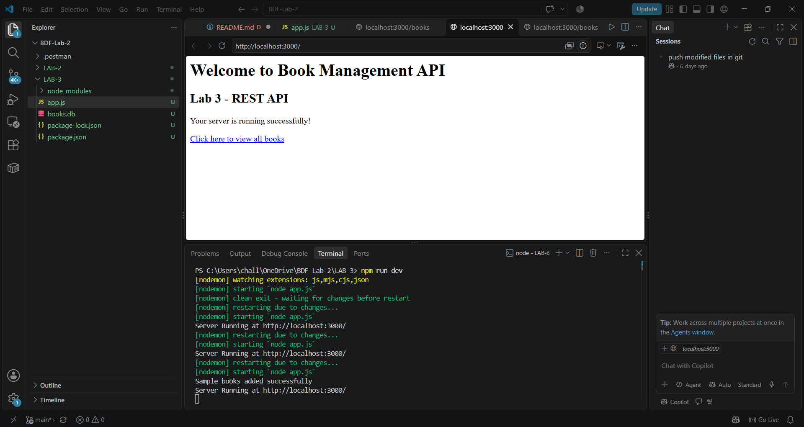
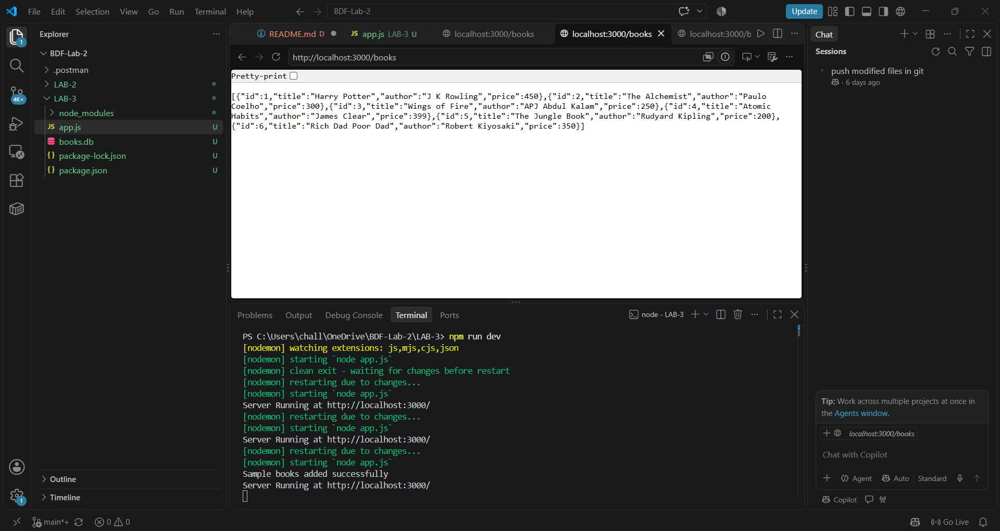
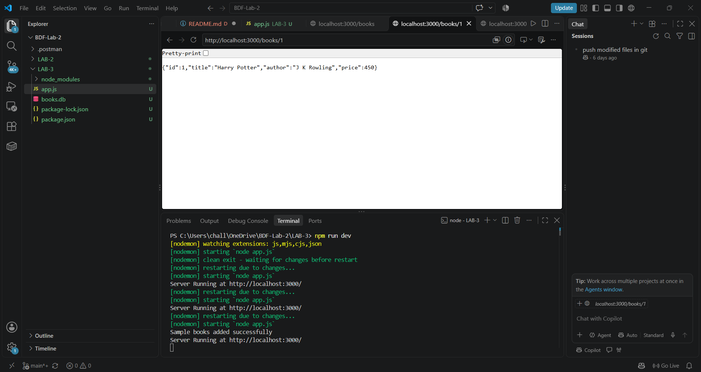
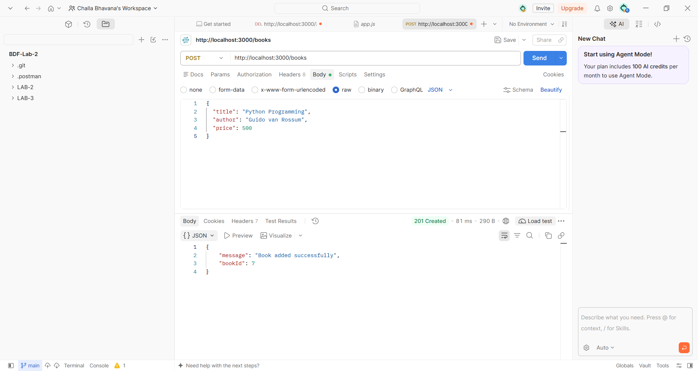
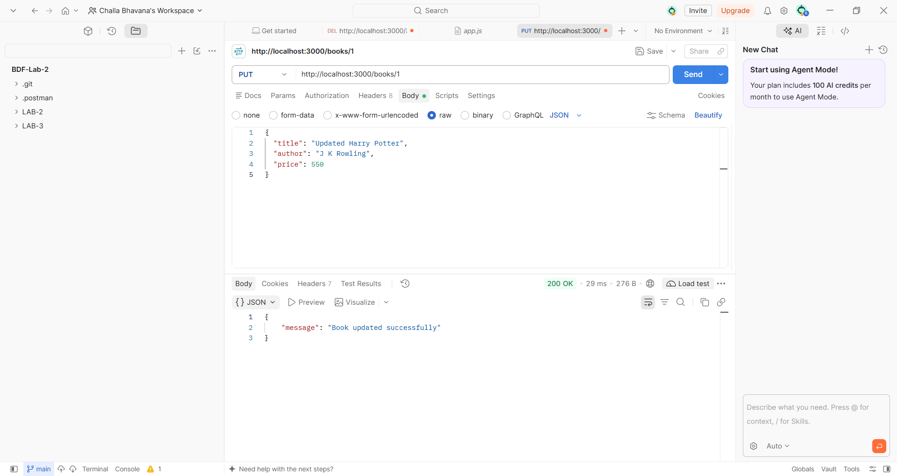
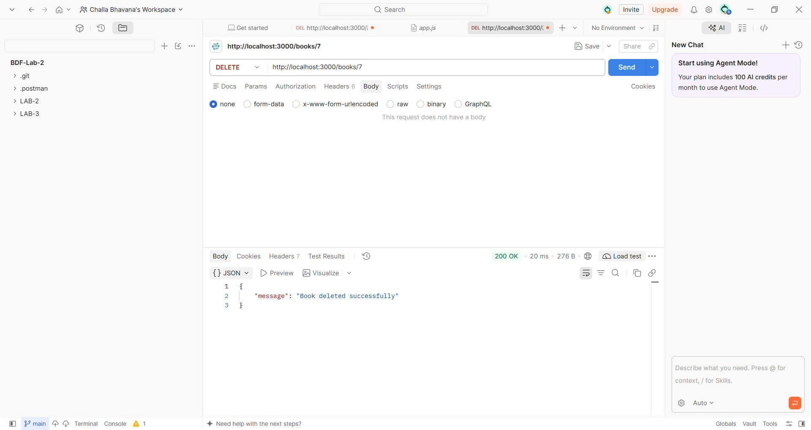
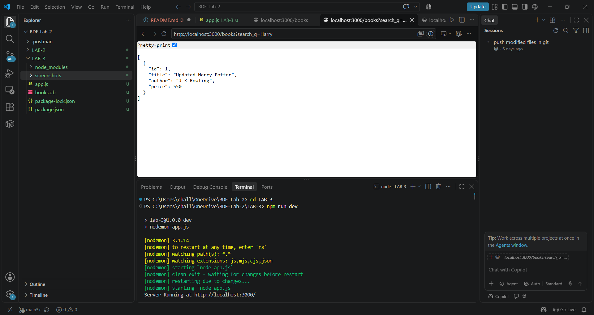
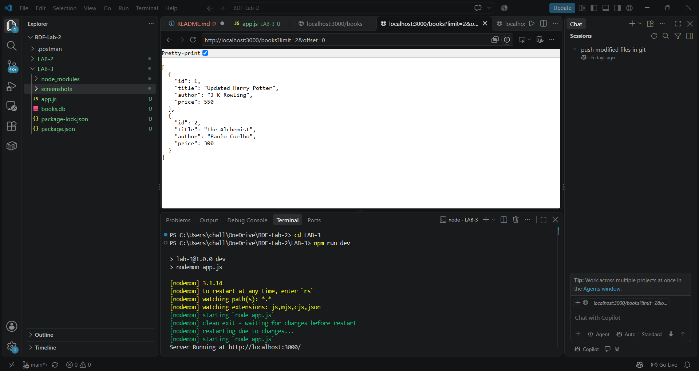

# Lab 3 – REST API Development

## Project Description

This project is developed as part of the Backend Development Fundamentals course. It is a REST API application built using Node.js, Express.js, and SQLite.

The project manages book information through CRUD operations. It also supports searching, sorting, pagination, price filtering, input validation, and error handling.

## Technologies Used

- Node.js
- Express.js
- SQLite
- JavaScript
- Express.js
- Postman
- Visual Studio Code

## Features

- View all books
- View a particular book using its ID
- Add new books
- Update existing book details
- Delete books
- Search books by title or author
- Sort books in ascending order
- Sort books in descending order
- Pagination using limit and offset
- Filter books using minimum and maximum price
- Input validation
- Error handling

## Project Structure

```text
BDF-Lab-2/
│
├── .postman/
│
├── LAB-2/
│
└── LAB-3/
    │
    ├── node_modules/        (Not uploaded to GitHub)
    │
    ├── screenshots/
    │   ├── delete.png
    │   ├── get-1.png
    │   ├── get-all.png
    │   ├── home.png
    │   ├── pagination.png
    │   ├── post.png
    │   ├── price filter.png
    │   ├── put.png
    │   ├── search.png
    │   ├── sort ascending.png
    │   └── sort descending.png
    │
    ├── app.js
    ├── books.db
    ├── package-lock.json
    ├── package.json
    └── README.md
```

## Installation and Setup

### Step 1: Clone the Repository

```bash
git clone https://github.com/ChallaBhavana-007/BDF-lab2/tree/main/LAB-3
```

### Step 2: Open the Project Folder

```bash
cd LAB-3
```

### Step 3: Install Dependencies

```bash
npm install
```

### Step 4: Start the Development Server

```bash
npm run dev
```

### Step 5: Open the Application

```text
http://localhost:3000/
```

## API Endpoints

| HTTP Method | Endpoint | Description |
|---|---|---|
| GET | `/books` | Get all books |
| GET | `/books/:id` | Get a book by ID |
| POST | `/books` | Add a new book |
| PUT | `/books/:id` | Update a book |
| DELETE | `/books/:id` | Delete a book |

## Query Parameters

| Parameter | Description |
|---|---|
| `search_q` | Search books by title or author |
| `order_by` | Sort books by a column |
| `order` | Sort in ASC or DESC order |
| `limit` | Specify the number of records |
| `offset` | Skip a specified number of records |
| `min_price` | Set the minimum book price |
| `max_price` | Set the maximum book price |

### Example API Requests

**1. Get All Books**

```text
GET http://localhost:3000/books
```

**2. Get Book by ID**

```text
GET http://localhost:3000/books/1
```

**3. Search Books**

```text
GET http://localhost:3000/books?search_q=Harry
```

**4. Sort Books in Ascending Order**

```text
GET http://localhost:3000/books?order_by=price&order=ASC
```

**5. Sort Books in Descending Order**

```text
GET http://localhost:3000/books?order_by=price&order=DESC
```

**6. Pagination**

```text
GET http://localhost:3000/books?limit=2&offset=0
```

**7. Price Filtering**

```text
GET http://localhost:3000/books?min_price=200&max_price=400
```

## Screenshots

### 1. Home Page



### 2. GET – View All Books



### 3. GET – Book by ID



### 4. POST – Add a New Book



### 5. PUT – Update Book Details



### 6. DELETE – Delete a Book



### 7. Search Books



### 8. Sorting – Ascending Order


### 9. Sorting – Descending Order


### 10. Pagination



### 11. Price Filtering


## Live Demo

**Live Project URL:**

Add your deployed Render URL here:

`https://bdf-lab3-qcqq.onrender.com`

## GitHub Repository

**GitHub Repository URL:**

Add your GitHub repository URL here:

`https://github.com/ChallaBhavana-007/BDF-lab2/tree/main/LAB-3`

## Learning Outcomes

Through this lab, I learned:

- How to create REST APIs using Node.js and Express.js.
- How to connect an SQLite database with a backend application.
- How to perform CRUD operations.
- How to use query parameters for searching and sorting.
- How to implement pagination and price filtering.
- How to validate user inputs.
- How to handle errors in REST APIs.
- How to test API requests using Postman.

## Conclusion

This lab helped me understand REST API development using Node.js, Express.js, and SQLite. I learned how to perform CRUD operations, work with query parameters, implement searching, sorting, pagination, and price filtering. I also gained practical experience in testing APIs using Postman and handling errors and validations. This project improved my backend development skills and helped me understand how real-world APIs work.