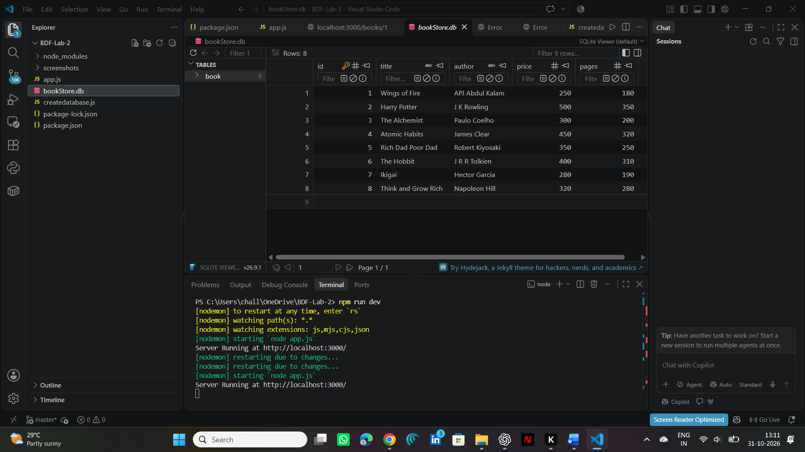
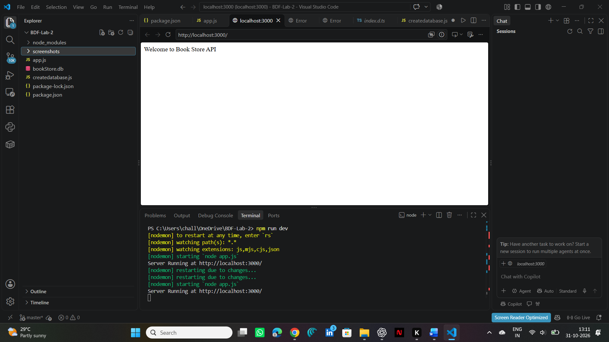
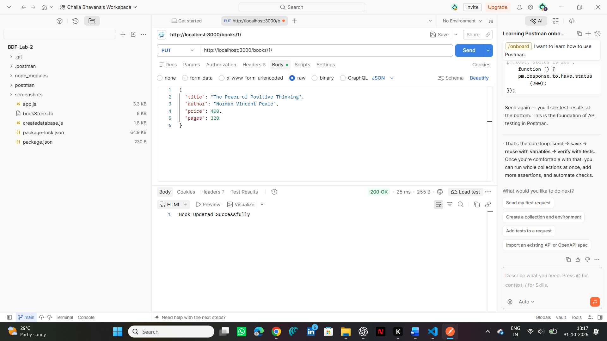
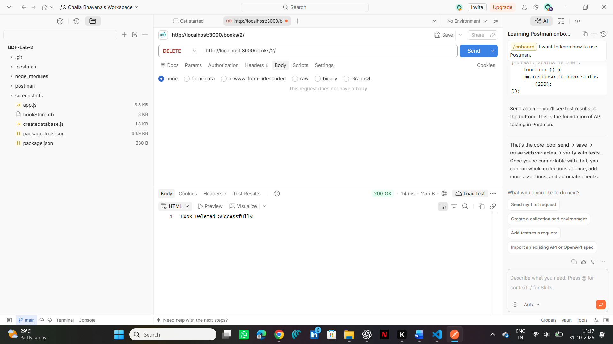

# Lab 2: SQLite Database and CRUD Routes

## Student Details
- **Name:** Challa Bhavana
- **Registration Number:** 253U1R1051
- **Section:** S-15
- **Course:** Backend Development Fundamentals
- **Year & Term:** Year II, Term II
- **Faculty:** Shiva Sai Teja

## Live Link
Not deployed yet. The project is running locally using Express.js on port 3000.

## Project Description
This project connects an Express.js server with an SQLite database. It performs CRUD operations (Create, Read, Update and Delete) using HTTP methods.

The database contains book details such as ID, title, author, price and pages.

## Technologies Used
- Node.js
- Express.js
- SQLite
- SQLite3
- JavaScript
- Postman
- Nodemon

## Project Structure

```text
BDF-Lab-2/
│
├── app.js
├── createDatabase.js
├── bookStore.db
├── package.json
├── package-lock.json
├── README.md
├── .gitignore
│
└── screenshots/
    ├── 1-database.png
    ├── 2-homepage.png
    ├── 3-getall.png
    ├── 4-getone.png
    ├── 5-post.png
    ├── 6-put.png
    └── 7-delete.png
```

## How to Install and Run

### Step 1: Install Dependencies

```bash
npm install
```

### Step 2: Install Nodemon

```bash
npm install --save-dev nodemon
```

### Step 3: Create the Database

```bash
node createDatabase.js
```

### Step 4: Start the Server

```bash
npm run dev
```

The server runs at:

http://localhost:3000/

## API Endpoints

| HTTP Method | Endpoint | Description |
|---|---|---|
| GET | / | Displays the welcome message |
| GET | /books/ | Displays all books |
| GET | /books/:bookId/ | Displays one book using ID |
| POST | /books/ | Adds a new book |
| PUT | /books/:bookId/ | Updates an existing book |
| DELETE | /books/:bookId/ | Deletes a book using ID |

## Screenshots

### 1. Database Creation


### 2. Homepage


### 3. Get All Books


### 4. Get One Book


### 5. POST - Add Book


### 6. PUT - Update Book


### 7. DELETE - Delete Book


## SQL Injection Prevention

Parameterized queries using `?` placeholders are used in SQL statements. This prevents SQL injection by separating user input from SQL commands.

## Status Codes

- **200:** Successful request.
- **201:** New book created successfully.
- **404:** Book not found.
- **500:** Internal server error.

## Notes: Problems Faced and Solutions

1. Initially, I faced an error while writing the package.json file. I corrected the JSON syntax.
2. I faced an issue because SQLite CLI was not installed. I used the SQLite extension in VS Code to view the database.
3. I received "Cannot GET /" because the home route was missing. I added a GET route for the homepage.
4. I learned how to connect SQLite with Express.js and perform CRUD operations.
5. I tested all five CRUD endpoints using Postman.

## Conclusion

Through this lab, I learned how to connect an Express.js server to an SQLite database and perform CRUD operations. I understood how GET, POST, PUT and DELETE methods work. I also learned to use parameterized SQL queries to prevent SQL injection. Testing the APIs using Postman helped me understand backend development practically.
